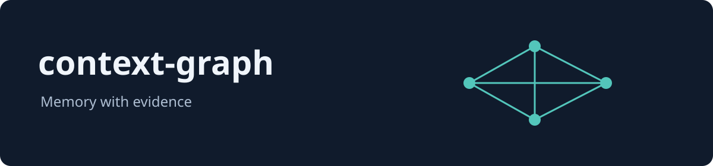

# context-graph



[](https://github.com/context-graph-ai/context-graph/actions/workflows/ci.yml)
[](LICENSE)
[](rust-toolchain.toml)

`cg find` returns stored passages from your imported Claude Code history for a question, each result carrying `cosine_similarity` and `embedding_space_id` fields, and `cg show` opens the exact source events linked by a result. <!-- enforced by: `event_history_journey_with_real_nomic_imports_finds_shows_and_forgets`, `search_wait_round_trip_reads_linked_exact_events_from_the_store_with_real_nomic` -->

<!-- concept -->
When a session ends, finding the conversation behind a choice can be harder than remembering the choice itself.

Use `cg forget` to remove selected imported history from subsequent searches. <!-- enforced by: `event_history_journey_with_real_nomic_imports_finds_shows_and_forgets` -->

`cg --version` prints the binary name and its version. <!-- enforced by: `cli_version` -->

Maintained by the [context-graph-ai organisation on GitHub](https://github.com/context-graph-ai), under the [Apache-2.0 licence](LICENSE).

## Download a development build

Development build, not a stable release. The first development build is published by the first run of the Build development binaries workflow. <!-- enforced by: `ci_runs_cargo_deny_and_cargo_expand_symbol_check` -->

```sh
set -eu
case "$(uname -s)/$(uname -m)" in
  Linux/x86_64) target=x86_64-unknown-linux-gnu ;;
  Darwin/arm64) target=aarch64-apple-darwin ;;
  *) echo "No development binary for this platform" >&2; exit 1 ;;
esac
base=https://github.com/context-graph-ai/context-graph/releases/download/dev-latest
curl -fLO "$base/cg-$target.tar.gz"
curl -fLO "$base/cg-$target.tar.gz.sha256"
if command -v sha256sum >/dev/null 2>&1; then
  sha256sum -c "cg-$target.tar.gz.sha256"
else
  shasum -a 256 -c "cg-$target.tar.gz.sha256"
fi
curl -fLO "$base/cg-$target.json"
python3 - "$target" <<'PY_RECEIPT'
import hashlib, json, pathlib, sys
stem = 'cg-' + sys.argv[1]
digest = hashlib.sha256(pathlib.Path(stem + '.tar.gz').read_bytes()).hexdigest()
receipt = json.loads(pathlib.Path(stem + '.json').read_text())
if receipt['sha256'] != digest:
    raise SystemExit('Receipt digest mismatch; download a complete matching asset set again')
print('Verified source commit:', receipt['context_graph_sha'])
PY_RECEIPT
tar -xzf "cg-$target.tar.gz"
./cg --version
export PATH="$PWD:$PATH"
cg model fetch --defaults
```

<!-- concept -->
Use the [download guide](docs/download.md) for wget, receipts and provenance verification, or the newest complete run-named fallback if verification fails. The receipt identifies the source commit, workflow run and attempt. <!-- enforced by: `ci_runs_cargo_deny_and_cargo_expand_symbol_check` --> For a source build, see [Contributing](CONTRIBUTING.md#build-from-source).

The pinned toolchain in `rust-toolchain.toml` is Rust **1.94.1**. <!-- enforced by: `readme_states_the_rust_version_rust_toolchain_toml_pins` -->

ContextDB is pinned to `878170bb142790f43ad73ff644ab8ae9eec1039f` in the manifests and lockfile. <!-- enforced by: `manifests_lockfile_and_readme_name_the_same_exact_contextdb_revision` -->

Linux is required by `PR checks`; macOS runs in the separate, nonblocking `macOS CI (advisory)` workflow. See the [macOS qualification follow-up](.github/CI.md#macos-qualification-follow-up). <!-- enforced by: `cg_github_actions_workflow_runs_on_matrix_of_macos_latest_ubuntu_latest_and_documents_the_deliberate_windows_exclusion` -->

The default local Nomic model download is 546,938,168 bytes (about 547 MB). <!-- enforced by: `first_touch_lazy_fetch_observer_event_payload_carries_resolved_source_and_byte_budget` -->

## First import and search

A question about imported history returns stored passages. <!-- enforced by: `event_history_journey_with_real_nomic_imports_finds_shows_and_forgets` -->

<!-- smoke: first-run -->
```sh
cd ~/projects/my-app
cg import . --context my-app --search wait --format text
cg find "why did we choose this approach?" --format json
cg show <passage-id> --format text
cg status --format text
```

<!-- concept -->
Illustrative example, not a guarantee: because scoring compares embeddings rather than words, a question can return a passage that shares none of its words, as in this synthetic session about renaming `src/auth.py`. No automated check covers result quality for reworded questions, so results on your own history can differ.

Try this synthetic session after fetching the default model:

```sh
(
export CG_MODEL_CACHE_ROOT="${CG_MODEL_CACHE_ROOT:-${XDG_CACHE_HOME:-$HOME/.cache}/cg/models}"
demo=$(mktemp -d)
mkdir -p "$demo/home"
cat > "$demo/session.jsonl" <<'JSONL'
{"type":"assistant","uuid":"00000000-0000-4000-8000-000000000001","sessionId":"rename-example","timestamp":"2026-09-01T09:00:00Z","message":{"role":"assistant","content":"Moved src/auth.py to src/authentication.py to avoid shadowing the third-party auth package."}}
JSONL
if grep -F 'login module' "$demo/session.jsonl"; then :; else printf 'grep: no matches\n'; fi
env HOME="$demo/home" CG_DATA_ROOT="$demo/data" cg import "$demo/session.jsonl" --context rename-demo --search wait --format text
env HOME="$demo/home" CG_DATA_ROOT="$demo/data" cg find "why did we rename the login module?" --context rename-demo --limit 1 --format text
)
```

Example output (ids and sizes differ on your machine):

```text
grep: no matches
context: rename-demo (explicit)
sources: 1 files / 1 sessions
history captured: 1 new events (0 already present)
semantic search: caught up
<passage-id>  rename-demo  2026-09-01  session rename-example
Assistant [author="assistant"]: Moved src/auth.py to src/authentication.py to avoid shadowing the third-party auth package.
```

<!-- concept -->
Replace the project path and question; use the passage id printed by `cg find`. Follow [getting started](docs/getting-started.md) for the complete output and [the forget recipe](skills/cg-forget/SKILL.md) to remove selected history.

## Current limits

Directory import selects the Claude Code sessions for the chosen project; a default library store places events locally. <!-- enforced by: `cg_import_project_directory_never_sweeps_working_tree_jsonl_or_imports_other_project_history`, `local_and_unbound_tenant_placement_keep_event_schema_and_append_behind_real_policy_binding` -->

An import with `--search wait` writes events and searchable passages, and creates no Intentions, Decisions, Entities or Observations ([definitions](docs/ontology.md)). <!-- enforced by: `importing_history_writes_events_and_passages_and_no_graph_rows` -->

A default import completes capture while search is blocked by missing local model artifacts, and downloads no model. <!-- enforced by: `missing_nomic_artifact_blocks_background_and_wait_without_download_while_defer_skips_preflight` -->

The resulting passages can be found after the original source file is removed. <!-- enforced by: `search_wait_round_trip_reads_linked_exact_events_from_the_store_with_real_nomic` -->

The library's default search preparation builds the ten newest sessions first. `cg import --search-sessions all --search-order oldest --search wait` completes coverage of all captured sessions. <!-- enforced by: `recent_session_scope_builds_the_ten_most_recent_newest_first_and_widens_without_reembedding`, `interrupted_all_scope_retry_resumes_all_sessions_in_the_same_oldest_order` -->

<!-- concept -->
See [privacy and data movement](docs/privacy-and-data-movement.md) for where data lives and when anything leaves the machine.

## Read next

For application builders, the Rust library persists goals across store reopen, keeps choices linked to the goals they serve, and retains the link between recorded evidence and an observation. See [the memory model](docs/ontology.md) and [library quickstart](docs/library-quickstart.md). <!-- enforced by: `intention_create_persists_across_reopen`, `decision_create_with_serves_and_based_on_edges_persisted`, `combination_record_observation_observation_evidence_snapshot_embedding_atomic_one_tx` -->

| Guide |
|---|
| [Documentation index](docs/SUMMARY.md) |
| [Install and first search](docs/getting-started.md) |
| [First library write and read](docs/library-quickstart.md) |
| [The memory problem](docs/why-context-graph.md) |
| [Architecture and the two memory layers](docs/how-it-works.md) |
| [Intentions, decisions and observations](docs/ontology.md) |
| [Local storage and hosted input](docs/privacy-and-data-movement.md) |
| [Presented commands and their contracts](docs/cli.md) |
| [Node configuration and budgets](docs/configuration.md) |
| [Models, artifacts and embedding spaces](docs/models-and-embedders.md) |
| [Library types and contracts](docs/library-api.md) |
| [Capabilities and limits](docs/capability-index.md) |
| [Register an embedding implementation](docs/register-an-embedder.md) |
| [Read without changing a store](docs/read-a-store-read-only.md) |
| [Refusals and recovery](docs/troubleshooting.md) |
| [Contributing](CONTRIBUTING.md) |
| [Security](SECURITY.md) |
| [Agent guide](AGENTS.md) |

Apache-2.0. See [LICENSE](LICENSE).
